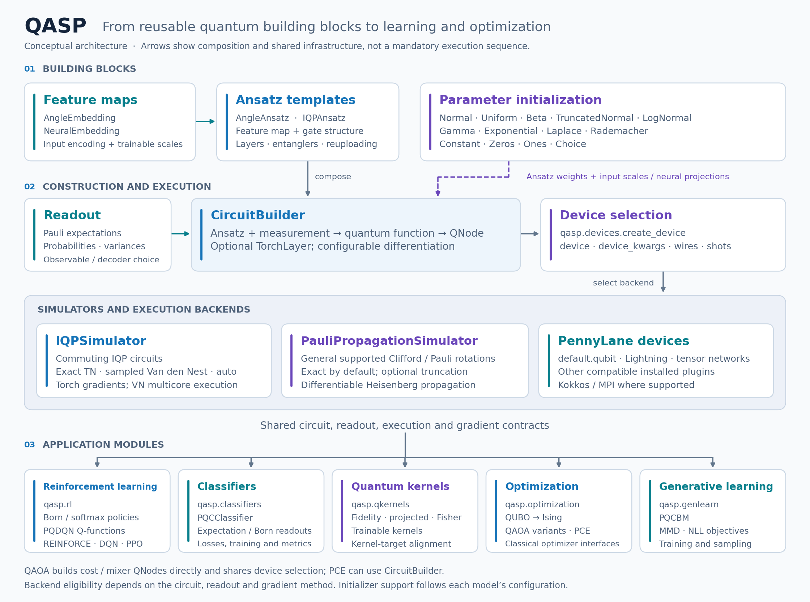
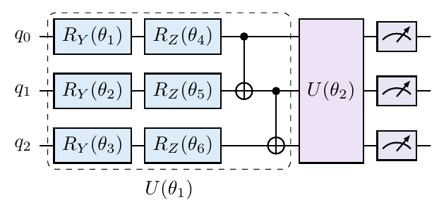
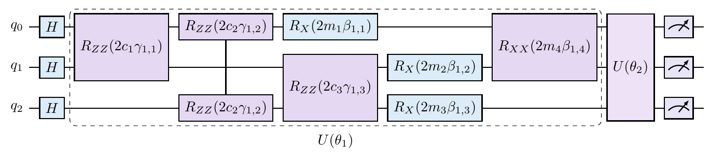
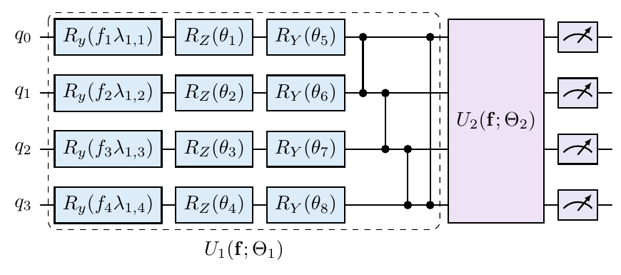
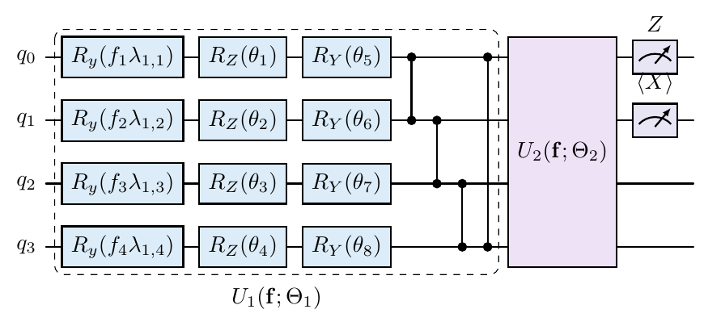
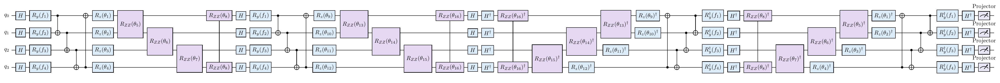
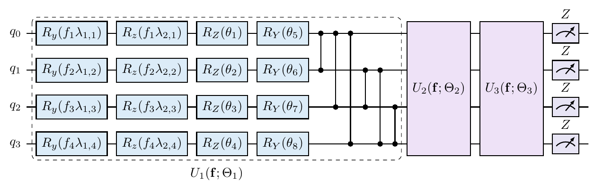
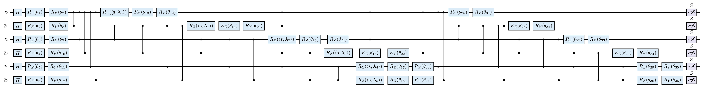
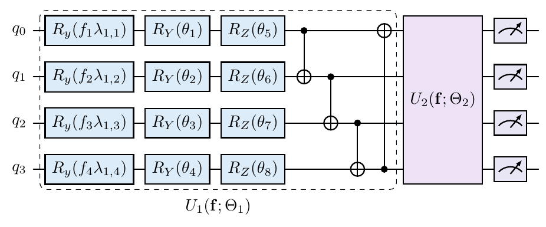
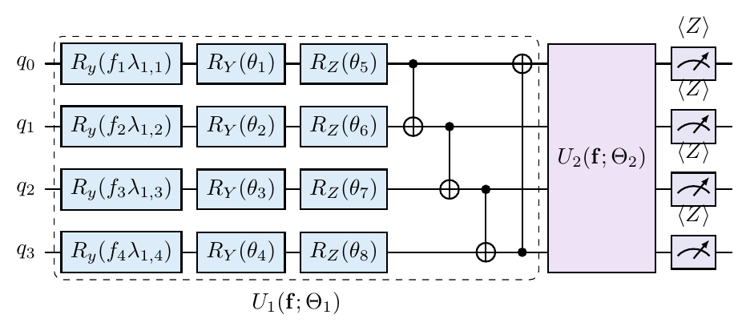

# QASP

<p align="center">
  <picture>
    <source media="(prefers-color-scheme: dark)" srcset="https://raw.githubusercontent.com/INESCTEC/qasp/main/docs/assets/qasp-logo-dark.png">
    <source media="(prefers-color-scheme: light)" srcset="https://raw.githubusercontent.com/INESCTEC/qasp/main/docs/assets/qasp-logo.png">
    
  </picture>
</p>

<p align="center">
  <a href="https://pypi.org/project/qasp/"></a>
  <a href="#installation"></a>
  <a href="https://github.com/INESCTEC/qasp/blob/main/pyproject.toml"></a>
  <a href="https://github.com/INESCTEC/qasp/blob/main/LICENSE"></a>
  <a href="https://andre-sequeira10.github.io/QASP/"></a>
</p>

**QASP** (**Q**uantum **A**gent **S**oftware **P**ackage) is a Python toolkit for
building, training and analyzing quantum models with PennyLane and PyTorch.
Shared circuit builders, feature maps, ansatz templates and initializers support
**reinforcement learning, classification, quantum kernels, generative learning
and combinatorial optimization**.

Run compatible models with PennyLane devices or QASP's differentiable
**IQPSimulator** (tensor networks, Van den Nest estimation or automatic selection)
and **PauliPropagationSimulator**. Reuse the same building blocks across modules,
with execution and gradient methods chosen for each circuit and readout.

**[Get started](#installation)** · **[Tutorials](https://github.com/INESCTEC/qasp/tree/main/tutorials)** · **[Examples](https://github.com/INESCTEC/qasp/blob/main/examples/README.md)** ·
**[Documentation website](https://andre-sequeira10.github.io/QASP/)** · **[Package guide](https://github.com/INESCTEC/qasp/blob/main/docs/package_guide.md)** · **[Architecture](#architecture)**

**Table of contents**

- [Highlights](#highlights)
- [Architecture](#architecture)
- [Documentation](#documentation)
- [Installation](#installation)
- [Dependencies](#dependencies)
- [Differentiable IQP simulation](#differentiable-iqp-simulation)
- [General differentiable Pauli propagation](#general-differentiable-pauli-propagation)
- [Package layout](#package-layout)
- [Top-level API](#top-level-api)
- [Distributed statevector simulation (MPI)](#distributed-statevector-simulation-mpi)
- [Manual circuit construction example](#manual-circuit-construction-example)
- [High level RL policies from dictionaries and `create_policy`](#high-level-rl-policies-from-dictionaries-and-create_policy)
- [Reinforcement learning example with REINFORCE](#reinforcement-learning-example-with-reinforce)
- [Policy classes in `qasp.rl.policies`](#policy-classes-in-qasprlpolicies)
- [Trainability and analysis utilities](#trainability-and-analysis-utilities)
- [Notebooks and example scripts](#notebooks-and-example-scripts)
- [End-to-end CartPole examples](#end-to-end-cartpole-examples)
- [Citing QASP](#citing-qasp)

---

## Highlights

- Build PQCs from composable **feature maps** and **ansätze**
- Train **Born** and **softmax** policies on Gym/Gymnasium-style environments
- Run lightweight **REINFORCE** training loops directly from QASP
- Evaluate trainability with utilities such as:
  - model-agnostic cost-concentration diagnosis,
  - policy variance,
  - exploratory Lie-closure dimensions (with documented heuristic limitations)
- Use PennyLane **lightning.qubit** / **lightning.kokkos** and the shared differentiable **PauliPropagationSimulator** (legacy `lightning.pp` remains available)
- Run differentiable commuting models with **IQPSimulator**: exact TN, sampled Van den Nest, or automatic selection, with multicore forward/backward execution
- Compare different observable/readout designs, including local `Z`, pairwise `ZZ`, and parity-based observables
- Build global-fidelity, local-fidelity, and projected quantum kernels, including trainable IQP encodings
- Optimize trainable kernels with centered kernel-target alignment
- Train binary and multiclass PQC classifiers with MSE, hinge, binary cross-entropy, or categorical cross-entropy
- Decode Born probabilities into classes with contiguous, parity, or majority partitions
- Evaluate classifiers with accuracy, balanced accuracy, precision, recall, F1, ROC AUC, PR AUC, confusion matrices, log loss, and Brier score
- Solve QUBOs with standard, multi-angle, warm-start, recursive, and linear-ramp QAOA
- Define custom QAOA mixers and PCE parameterized circuits with QASP dictionaries
- Export [paper-ready circuit drawings](#exporting-publication-ready-tikz-circuits) as editable TikZ/Quantikz, with symbolic parameters, gate colors, and repeated-layer compression

---

## Architecture

Feature maps (`AngleEmbedding`, `NeuralEmbedding`) supply input encoding to
ansatz templates (`AngleAnsatz`, `IQPAnsatz`). `CircuitBuilder` combines the
ansatz with a measurement and compiles it into a QNode, optionally wrapped in a
trainable TorchLayer. Initializers configure circuit weights and input scales;
the shared device layer selects a compatible simulator. These components support
RL, classifiers, kernels, optimization and generative learning.

[](https://github.com/INESCTEC/qasp/blob/main/docs/assets/architecture/qasp-architecture.svg)

[Editable vector diagram](https://github.com/INESCTEC/qasp/blob/main/docs/assets/architecture/qasp-architecture.svg) ·
[PNG](https://github.com/INESCTEC/qasp/blob/main/docs/assets/architecture/qasp-architecture.png) ·
[Rendering source](https://github.com/INESCTEC/qasp/blob/main/docs/assets/architecture/render_architecture.py)

This is a conceptual dependency view. QAOA constructs cost/mixer QNodes directly
and shares device selection; PCE can use `CircuitBuilder`. Backend compatibility
still depends on the circuit, measurement and differentiation method. Full
initializer options are listed under [parameter initialization](#parameter-initialization).

## Documentation

The [module tutorials](https://github.com/INESCTEC/qasp/tree/main/tutorials) are runnable Jupyter notebooks covering circuit construction, training, results, Matplotlib and TikZ drawings, trainability diagnostics and differentiable simulation.

In Jupyter, `draw_classifier(model, inputs=x, output="tikz", return_tex=False)`
displays the circuit inline. To keep the LaTeX as well, omit `return_tex` and
assign the result to `tex`.
The same convention applies across module drawing helpers.
See the [drawing guide](docs/package_guide.md#preview-any-circuit-in-jupyter)
for optional rendering dependencies and examples.

Explore the **[interactive QASP documentation](https://andre-sequeira10.github.io/QASP/)**:
Building Blocks → Simulators → Modules, with step-by-step configuration,
training and visualization examples, searchable APIs and argument descriptions.


This repository contains the library, regression tests and a [curated example set](https://github.com/INESCTEC/qasp/blob/main/examples/README.md). Notebook outputs, experiment datasets and paper sources/PDFs are kept in the [upstream research archive](https://github.com/andre-sequeira10/QASP/tree/3bda8622bd6f5ddfb7c05a0dfd0538c1b0ccd718). See the [repository layout policy](https://github.com/INESCTEC/qasp/blob/main/docs/repository_layout.md) for what is retained and how to keep the checkout small.

Start with the [package guide](https://github.com/INESCTEC/qasp/blob/main/docs/package_guide.md) for the complete module
map, executable examples, data shapes and implementation boundaries, alongside
the package’s module and API docstrings.
The [documentation audit](https://github.com/andre-sequeira10/QASP/blob/3bda8622bd6f5ddfb7c05a0dfd0538c1b0ccd718/docs/documentation_audit.md) records verification and
environment limitations. Focused guides cover [Q-functions](https://github.com/INESCTEC/qasp/blob/main/docs/qfunctions.md)
and [generative learning](https://github.com/INESCTEC/qasp/blob/main/docs/genlearn.md). The [unified IQP guide](https://github.com/INESCTEC/qasp/blob/main/docs/iqp_simulator.md)
explains `IQPSimulator`, exact TN versus sampled VN, gradients, automatic selection
and resource limits. Start with the [IQP tutorial](https://github.com/INESCTEC/qasp/blob/main/examples/iqp_simulator.ipynb)
or [parallel-gradient neural-policy example](https://github.com/andre-sequeira10/QASP/blob/3bda8622bd6f5ddfb7c05a0dfd0538c1b0ccd718/examples/iqp_parallel_backward.ipynb).
The [QASP software paper](https://github.com/andre-sequeira10/QASP/blob/3bda8622bd6f5ddfb7c05a0dfd0538c1b0ccd718/qasp_paper/output/pdf/qasp_software_paper.pdf) includes
selected IQP experiments and the shared Pauli simulator’s mathematics, limitations
and validated application examples. The [Pauli-propagation guide](https://github.com/INESCTEC/qasp/blob/main/docs/pauli_propagation.md)
covers configuration and migration; the [dedicated IQP paper](https://github.com/andre-sequeira10/QASP/blob/3bda8622bd6f5ddfb7c05a0dfd0538c1b0ccd718/docs/iqp_tn_paper/iqp_tn_simulator_paper.pdf)
contains the full mathematical and performance study.

## Installation

QASP **0.1.3** is an alpha research release. It requires **Python 3.10 or
newer**, subject to dependency support; Python 3.12 is a tested starting point.

### From PyPI

Create an isolated environment, then install the published package:

```bash
python3.12 -m venv .venv
source .venv/bin/activate
python -m pip install --upgrade pip
python -m pip install qasp
python -m pip check
python -c "from importlib.metadata import version; import qasp; print(version('qasp'))"
```

The package includes its core Python dependencies. Optional PennyLane device
plugins, GPU/MPI libraries and tensor-device dependencies require separate
installation appropriate to your platform. See the
[device and compilation guide](https://andre-sequeira10.github.io/QASP/#/guide/execution?step=compile).

### From source

```bash
git clone https://github.com/INESCTEC/qasp.git
cd qasp
python -m pip install -e .
```

### Development install

```bash
python -m pip install -e .[dev]
```

---

## Dependencies

QASP relies primarily on:

- `pennylane`
- `torch`
- `numpy`
- `scipy`
- `autograd`
- `opt_einsum` (exact IQP contraction)
- `gymnasium`
- `torchrl`
- `tensordict`
- `matplotlib`
- `pandas`
- `ray[rllib]`

The tested dependency ranges are in [pyproject.toml](https://github.com/INESCTEC/qasp/blob/main/pyproject.toml). See the
[compatibility matrix](https://github.com/INESCTEC/qasp/blob/main/docs/dependency_compatibility.md) for Python 3.10–3.12
results on macOS arm64, reproducible version constraints and known limitations.
Each of four clean profiles passes 746 tests, with three optional Kokkos tests
skipped; the reference `torchlane` environment passes all 749 tests.

PennyLane tensor-network comparison experiments additionally use `quimb`;
QASP's IQP TN route uses `opt_einsum`.

---

## Differentiable IQP simulation

`IQPSimulator` executes compatible commuting quantum models through one device:

| `backend` | Computation | Suitable readouts |
|---|---|---|
| `"tn"` | Exact tensor-network contraction with Torch gradients | Supported moments and structured Born/action probabilities |
| `"van_den_nest"` | Differentiable Monte Carlo correlation estimates | Real I/Z expectations; optional compact projector importance sampling |
| `"auto"` (default) | Chooses an eligible route using resource estimates | Depends on the circuit, readout and approximation budget |

The shared construction is a circuit of commuting X-string rotations on
`|0...0>`, or its equivalent closed Hadamard-frame Z circuit. RX, RXX and RXXX
`AngleAnsatz` layers and matching-axis feature encodings are examples.
`IQPAnsatz` configurations must also satisfy the circuit/readout contract;
arbitrary noncommuting gates are not made eligible by the device name.
TN accepts a broader recognized product-basis circuit family.

This complete example constructs a QASP policy directly: the configuration
selects the commuting ansatz, neural embedding, observables and IQP backend.
`PQCSoftmax` returns logits, so the training loss applies `log_softmax` to form
action log-probabilities.

```python
import numpy as np
import torch
from qasp import AngleAnsatz, NeuralEmbedding
from qasp.rl.policies import PQCSoftmax

n = 8
config = {
    "ansatz": AngleAnsatz,
    "ansatz_config": {
        "n_qubits": n, "n_layers": 2,
        "rotations": ([f"X {w}" for w in range(n)]
                      + [f"XX {w} {w+1}" for w in range(n-1)]
                      + [f"XXX {w} {w+1} {w+2}" for w in range(n-2)]),
        "include_imprimitive": False,
        "include_hadamards_initial": False, "reuploading": True,
    },
    "feature_map": NeuralEmbedding,
    "feature_map_config": {"n_qubits": n, "features": 4,
                           "rotations": "X"},
    "n_actions": 2, "observables": ["Z 0", f"Z {n-1}"],
    "fc_layer": None,
    "device": "IQPSimulator",
    "device_kwargs": {"backend": "auto", "mode": "explicit",
                      "vn_samples": 4096, "vn_workers": 4,
                      "vn_parallel_backward": True, "seed": 2026},
    "diff_method": "backprop", "shots": None,
}
policy = PQCSoftmax(n_qubits=n, **config).double()
x = torch.tensor(np.array([.2, -.4, .3, .1]), dtype=torch.float64,
                 requires_grad=True)
optimizer = torch.optim.Adam(policy.parameters(), lr=.01)
optimizer.zero_grad()
loss = -torch.log_softmax(policy(x), dim=-1)[1]
loss.backward()
assert torch.isfinite(x.grad).all()
assert all(p.grad is not None and torch.isfinite(p.grad).all()
           for p in policy.parameters())
optimizer.step()  # Updates circuit and neural-embedding parameters.
print(policy.circuit.device.last_report.selected)
```

Change `config["device_kwargs"]["backend"]` **before constructing the policy**
to `"tn"`, `"van_den_nest"`, or `"auto"`. The same device fields can be used
in compatible QASP model-factory dictionaries. No hand-written circuit or
QNode is required.

Gradients propagate through shared circuit parameters, inputs, observable
coefficients and compatible neural embeddings. This supports IQP-based RL
policies, expectation classifiers, projected kernels, generative moment-MMD
and compatible optimization circuits. Probability-based majority policies use
TN; generic QAOA circuits and arbitrary readouts are not VN workloads.
See the [public-model tutorial](https://github.com/INESCTEC/qasp/blob/main/examples/iqp_simulator.ipynb) for
complete configurations and the [parallel-gradient neural-policy example](https://github.com/andre-sequeira10/QASP/blob/3bda8622bd6f5ddfb7c05a0dfd0538c1b0ccd718/examples/iqp_parallel_backward.ipynb)
for Adam training.

VN estimates have sampling error even with `shots=None`; its classical samples
are not quantum-output samples. `vn_samples`, `vn_error` and `vn_confidence`
control additive expectation accuracy, not nonlinear-loss or gradient error.
Use `allow_approximate=False` or `backend="tn"` for exact execution.
`mode="explicit"` disables the separate small-statevector fallback while
retaining automatic TN/VN selection. `last_report` exposes choices, estimates
and uncertainty. `auto` is a heuristic, not a guarantee of the fastest backend.

CPU chunk workers parallelize **both forward and backward**. Effective
concurrency is bounded by the number of sample chunks; numerical thread pools
should be configured at application level to avoid oversubscription.
The worker default is one, and this backend does not implement MPI or
multi-node execution. Higher derivatives are supported on tested eager Torch
paths, with additional memory for retained derivative graphs.
`IQPTNSimulator` remains available as the exact-only compatibility interface.

The [unified guide](https://github.com/INESCTEC/qasp/blob/main/docs/iqp_simulator.md) describes contracts, importance
sampling and selection controls. The [CPU benchmark report](https://github.com/andre-sequeira10/QASP/blob/3bda8622bd6f5ddfb7c05a0dfd0538c1b0ccd718/docs/benchmarks/iqp_parallel_backward.md)
compares previous/new gradient scheduling and 1–8 workers. The
[IQP research paper](https://github.com/andre-sequeira10/QASP/blob/3bda8622bd6f5ddfb7c05a0dfd0538c1b0ccd718/docs/iqp_tn_paper/iqp_tn_simulator_paper.pdf) contains the
TN/VN/PennyLane comparison through 100 qubits, including startup, gradients,
resource stops and accuracy qualifications. Selected results are also included
in the [QASP software paper](https://github.com/andre-sequeira10/QASP/blob/3bda8622bd6f5ddfb7c05a0dfd0538c1b0ccd718/qasp_paper/output/pdf/qasp_software_paper.pdf).
These are measured CPU workloads, not universal speedup or equal-accuracy claims.

---

## General differentiable Pauli propagation

`PauliPropagationSimulator` lives in `qasp.simulators` alongside `IQPSimulator`
and is also exported from `qasp`. It handles noncommuting circuits through
Clifford and arbitrary Pauli-rotation propagation, with exact execution by default.
Use the same device fields in RL, classifiers, kernels, generative learning and
optimization:

```python
execution = {
    "device": "PauliPropagationSimulator",
    "device_kwargs": {"k": None, "prune": False},
    "diff_method": "backprop",
    "shots": None,
}
```

For example, construct and train a noncommuting neural policy directly through
`qasp.rl.policies` using that execution dictionary:

```python
import numpy as np
import torch
from qasp import AngleAnsatz, NeuralEmbedding
from qasp.rl.policies import PQCSoftmax

policy = PQCSoftmax(
    n_qubits=3, n_actions=2,
    ansatz=AngleAnsatz,
    ansatz_config={
        "n_qubits": 3, "n_layers": 2,
        "rotations": ["Y 0", "Z 1", "X 2", "XYZ 0 1 2"],
        "include_imprimitive": True, "imprimitive": "CNOT",
        "imprimitive_pattern": "chain", "reuploading": True,
    },
    feature_map=NeuralEmbedding,
    feature_map_config={"n_qubits": 3, "features": 2, "rotations": "Y"},
    observables=["Z 0", "XZ 1 2"], fc_layer=None, **execution,
).double()
x = torch.tensor(np.array([.2, -.4]), dtype=torch.float64, requires_grad=True)
optimizer = torch.optim.Adam(policy.parameters(), lr=.01)
optimizer.zero_grad()
loss = -torch.log_softmax(policy(x), dim=-1)[1]
loss.backward()  # Circuit parameters, neural embedding and inputs share the graph.
assert torch.isfinite(x.grad).all()
assert all(p.grad is not None and torch.isfinite(p.grad).all()
           for p in policy.parameters())
optimizer.step()
```

| Application | Supported analytic paths |
| --- | --- |
| RL | Observable policies, Born policies and PQDQN; neural PQDQN inputs use sequential batching. |
| Classifiers | Expectation scores and Born probabilities with Torch training. |
| Kernels | Global/local fidelity projectors and projected Pauli kernels, including trainable Gram matrices. |
| Generative learning | Expectation-based MMD and probability-based NLL; sampling uses an explicitly selected sampling device. |
| Optimization | Torch QAOA and PCE, including multilayer noncommuting circuits. |

The [complete direct-QASP example](https://github.com/INESCTEC/qasp/blob/main/examples/pauli_propagation_modules.py) trains
a neural policy and exercises PQDQN, a classifier, a fidelity kernel, MMD, QAOA
and PCE with this configuration. Use `backend="torch"` for optimization. Torch
gradients include circuit parameters, inputs, neural embeddings and observable
coefficients; analytic expectations, variances and probabilities are supported.
Run the application example with:

```sh
conda run -n torchlane python examples/pauli_propagation_modules.py
```

The public imports are `from qasp import PauliPropagationSimulator` and
`from qasp.simulators import PauliPropagationSimulator`. QASP accepts the class,
a configured instance, or the device name shown above. These names are resolved
by QASP, rather than registered as external PennyLane plugins.

Exact Pauli expansions can grow exponentially. Dense probabilities require
`2**m` moments for `m` measured wires and default to a 16-wire readout limit.
Optional weight truncation/coefficient pruning changes both outputs and
gradients. Finite shots, noise, amplitude-vector `StatePrep`, statevector outputs
and MPI are unsupported. Supported unitary templates are decomposed into native
Clifford/Pauli rotations; unsupported operations raise an error. Scalar tapes
are evaluated sequentially, with no dedicated worker pool.
Existing `lightning.pp` adapters and old engine imports remain compatible;
see the [algorithm, module coverage and migration guide](https://github.com/INESCTEC/qasp/blob/main/docs/pauli_propagation.md).

---

## Package layout

```text
qasp/
├── circuits/
│   ├── constructor.py      # CircuitBuilder and compilation utilities
│   ├── templates.py        # Ansatz templates such as IQPAnsatz and AngleAnsatz
│   ├── tikz.py             # Quantikz/TikZ circuit export
│   └── uqc.py              # Historical circuit prototype (see limitations)
├── feature_maps/
│   └── templates.py        # AngleEmbedding and NeuralEmbedding
├── genlearn/
│   ├── models.py           # PQCBM training and device sampling
│   ├── factory.py          # Dictionary-based create_qcbm
│   ├── drawing.py          # draw_qcbm / Quantikz export
│   └── losses.py           # NLL and expectation-mixture MMD
├── qkernels/
│   ├── kernels.py          # Fisher-information kernel utilities
│   ├── quantum_kernels.py  # Fidelity, local-fidelity, and projected kernels
│   ├── factory.py          # Configuration-driven kernel construction
│   ├── kta.py              # Kernel-target alignment
│   └── use_cases/          # Kernel experiments and examples
├── classifiers/
│   ├── models.py           # PQCClassifier expectation/Born readouts
│   ├── decoders.py         # Contiguous, parity, and majority class decoders
│   ├── losses.py           # MSE, hinge, BCE, and categorical CE
│   ├── metrics.py          # Classification evaluation metrics
│   ├── training.py         # Compact PyTorch training/evaluation loop
│   └── factory.py          # create_classifier configuration factory
├── optimization/
│   ├── problem.py          # QUBO model and QUBO-to-Ising conversion
│   ├── qaoa.py             # standard, multi-angle, warm-start, and LR-QAOA
│   ├── recursive.py        # recursive QAOA elimination and reconstruction
│   ├── pce.py              # Pauli Correlation Encoding with QASP ansätze
│   └── optimizers.py       # reusable SciPy optimizer adapters
├── simulators/             # IQPSimulator, PauliPropagationSimulator and shared engines
├── diagnostics/
│   └── barren_plateau.py   # classifier/kernel/policy cost concentration
├── devices.py              # Shared device/MPI option handling
├── initialization.py       # Reusable NumPy/Torch parameter distributions
└── rl/
    ├── model.py            # create_policy, draw_model
    ├── policies.py         # PQCBorn, PQCSoftmax, related policy classes
    ├── metrics.py          # Legacy probability variance / heuristic Lie closure
    ├── pp_sim.py           # truncated Pauli propagation simulator
    ├── differentiable_pp_sim.py
    ├── torchrl.py          # DQN, REINFORCE, PPO, bandits and TorchRL adapter
    ├── qfunctions/         # PQDQN models, Pauli readouts and drawings
    ├── envs.py             # Windy target-navigation environment
    └── trl.py              # Historical TorchRL prototype (see limitations)

examples/                   # Curated tutorials and supporting scripts

tests/
├── test_*.py               # Runtime/API regression tests
└── tests_deucalion/        # Cluster scripts and MPI smoke checks
```

---

## Top-level API

The package re-exports the most common entry points from `qasp.__init__`.

### Parameter initialization

Use reusable distributions from `qasp.initialization` to initialize ansatz
weights and feature-map input scales independently:

```python
from qasp import create_classifier
from qasp.initialization import Normal, Uniform

config = {
    "feature_map": "AngleEmbedding",
    "feature_map_config": {"rotations": "Y", "input_scaling": True},
    "ansatz": "AngleAnsatz",
    "ansatz_config": {"n_layers": 2, "rotations": "YZ", "reuploading": True},
    "init": Normal(mu=0.0, std=0.2),
    "input_scaling_init": Uniform(low=0.8, high=1.2),
    "device": "default.qubit",
}
classifier = create_classifier(config, n_qubits=4, n_classes=2)
```

The same `init` and `input_scaling_init` settings work with `create_policy`,
`create_qfunction`, trainable `create_kernel` models, and `create_qcbm`.
They apply to every reuploading layer and to `NeuralEmbedding` projection
weights. Classical output heads keep their existing initialization.

Available specifications are `Normal(mu, std)`, `Uniform(low, high)`,
`Beta(alpha, beta, low=0, high=1)`, `TruncatedNormal(mu, std, low, high)`,
`LogNormal(mu, std)`, `Gamma(concentration, rate)`, `Exponential(rate)`,
`Laplace(mu, scale)`, `Rademacher(scale=1)`, `Constant(value)`, `Zeros()`,
`Ones()`, and `Choice(values)`. `Normal.std` means
standard deviation. Specifications are immutable and can be reused across
models; each construction draws fresh weights. Legacy strings such as
`"normal_0_1"` and `"random_-pi_pi"` still work. Unknown names raise an error.

Suggested starting points (compare them on your circuit and data):

| Goal | Initializer | Why try it |
| --- | --- | --- |
| Small ansatz rotations | `Normal(0, 0.1)` | Simple centered baseline |
| Small rotations with strict bounds | `TruncatedNormal(0, 0.1, -0.2, 0.2)` | Samples a conditioned normal without clipping values at the endpoints |
| Bounded, center-concentrated angles | `Beta(2, 2, low=-0.3, high=0.3)` | Controls concentration as well as range |
| `AngleEmbedding` input scales near one | `Beta(5, 5, low=0.8, high=1.2)` | Mean one with a fixed allowed interval |
| Positive scales with mean one | `LogNormal(-0.005, 0.1)` or `Gamma(100, 100)` | Positive alternatives without a hard upper bound |
| Signed `NeuralEmbedding` projections | `Normal(0, 1 / np.sqrt(n_features))` | A variance-based starting point for standardized, roughly independent features |
| Equal-magnitude random signs | `Rademacher(0.1)` | Discrete symmetric weights |
| Sharper center with occasional larger values | `Laplace(0, 0.1)` | Heavier tails than a normal distribution |
| Positive values concentrated near zero | `Exponential(rate=10)` | Mean 0.1; useful when that asymmetric start is intentional |

There is no universally best distribution, and small rotations alone do not
guarantee good gradients. For a first comparison, use small Normal versus
TruncatedNormal angles, with Beta or `Ones()` for AngleEmbedding scales.
NeuralEmbedding scales are projection weights, so a centered distribution is
usually a more useful starting point there. Xavier/Kaiming initializers depend
on a neural layer's fan-in/fan-out and activation; QASP's flat angle vectors
do not contain that structure ([PyTorch initialization reference](https://docs.pytorch.org/docs/stable/nn.init.html)).

Beta's `alpha` and `beta` must be positive: equal values above one concentrate
near the midpoint, values below one favor the ends, and unequal values skew
the distribution ([NumPy Beta reference](https://numpy.org/doc/stable/reference/random/generated/numpy.random.Generator.beta.html)).
TruncatedNormal's bounds are actual parameter values; `mu` and `std` describe
the underlying normal before truncation ([SciPy reference](https://docs.scipy.org/doc/scipy/reference/generated/scipy.stats.truncnorm.html)).
LogNormal's `mu` and `std` are in log space, Gamma uses **rate** rather than
scale, and Laplace's standard deviation is `sqrt(2) * scale`.

```python
from qasp.initialization import Beta, TruncatedNormal

config["init"] = TruncatedNormal(mu=0, std=0.1, low=-0.2, high=0.2)
config["input_scaling_init"] = Beta(alpha=5, beta=5, low=0.8, high=1.2)
classifier = create_classifier(config, n_qubits=4, n_classes=2)
```

The initialized quantum weights remain trainable PyTorch parameters. For
example, continue with the classifier above and update both parameter groups
with Adam:

```python
import torch

torch.manual_seed(7)  # Set before constructing the model for reproducible weights.
classifier = create_classifier(config, n_qubits=4, n_classes=2)
optimizer = torch.optim.Adam(classifier.parameters(), lr=0.01)
inputs = torch.tensor([[0.2, -0.3, 0.1, 0.4], [-0.1, 0.5, 0.2, -0.4]])
targets = torch.tensor([0, 1])

optimizer.zero_grad()
loss = classifier.compute_loss(inputs, targets, objective="cross_entropy")
loss.backward()
optimizer.step()
```

Initialization runs only at construction, not on every optimizer step.
PQCBM uses `interface="torch"` by default; QAOA and PCE use
`backend="torch"` for Torch optimization.

`CircuitBuilder.create_torchlayer` uses `initialization=Normal(...)` and
`input_scaling_init=Uniform(...)`. Explicit `params` and
`input_scaling_params` arrays override only their own group. If no scale
initializer is supplied, Torch layers use the ansatz initializer for both
groups; PQCBM preserves its default input scales of one. Supplying a scale
initializer requires an input-scaling feature map. Encoding-only kernels
can use it to sample fixed scales once.

Optimization models accept the same objects at construction or at solve time:

```python
from qasp import QAOA, QUBO
from qasp.initialization import Normal, Uniform

problem = QUBO.maxcut(3, [(0, 1), (1, 2), (0, 2)])
solver = QAOA(problem, n_layers=2, init=Normal(0.0, 0.15), seed=7)
angles = solver.initial_parameters()  # Uses the constructor's initializer.
result = solver.solve(initial_parameters=Uniform(-0.2, 0.2))  # Optional override.
```

This also applies to multi-angle QAOA, warm-start QAOA, PCE, and RQAOA's
subproblem solvers. They have no input-scaling parameter group. LR-QAOA keeps
its deterministic schedule, configured by `delta_gamma` and `delta_beta`.
The concentration diagnoser accepts `initialization=Normal(...)` plus
`input_scaling_init=...` for independent resampling.

Seed Torch before constructing Torch-layer models with `torch.manual_seed`.
PQCBM, QAOA and PCE use their local `seed` for built-in distributions;
diagnostics use their local seeded generator. Explicit-parameter APIs such
as `QFKernel` can use `Normal(...).sample(shape, rng=np.random.default_rng(7))`.
Torch-style custom callables are also accepted and control their own randomness.
NumPy and Torch use different RNG algorithms, so equal seeds do not imply
identical samples across backends.
Beta, Gamma, Laplace and TruncatedNormal use a local CPU sampler seeded from
Torch's RNG when filling tensors, then copy values to the target dtype/device.
A supplied `torch.Generator` controls this without changing either global RNG.
The other built-in distributions use native Torch fills. This sampling happens
only during initialization; the resulting model parameters remain trainable.

See the [cross-module initialization notebook](https://github.com/INESCTEC/qasp/blob/main/examples/initialization_across_modules.ipynb)
for creation, gradients, training, reproducibility and compatibility checks.
Use `Choice((0, np.pi / 2))` for explicit discrete values: the historical
`"discrete_0_pi_over_2"` alias retains its old 0/pi meaning in the builder
and its 0/pi-over-2 meaning in diagnostics.

### Circuits

- `CircuitBuilder`
- `IQPAnsatz`
- `AngleAnsatz`
- `UQC`

### Feature maps

- `AngleEmbedding`
- `NeuralEmbedding`

### Generative learning

- `PQCBM`, `create_qcbm`, `draw_qcbm`, `PauliMMD`
- `BornMachine` (deprecated compatibility wrapper)

See [the generative-learning guide](https://github.com/INESCTEC/qasp/blob/main/docs/genlearn.md) and
[the runnable PQCBM notebook](https://github.com/INESCTEC/qasp/blob/main/examples/pqcbm_generative_learning.ipynb) for
expectation-based MMD, differentiable Pauli propagation, sampling, and MPI.

A three-qubit Born machine generates bitstrings by measuring a two-layer
`AngleAnsatz`. This example displays its sampling circuit in Jupyter before training.

<!-- readme-circuit: generative -> born_machine.tex -->

```python
from qasp import create_qcbm, draw_qcbm

model = create_qcbm({
    "ansatz": "AngleAnsatz",
    "ansatz_config": {
        "n_layers": 2,
        "rotations": "YZ",
        "include_imprimitive": True,
        "imprimitive": "CNOT",
        "imprimitive_pattern": "chain",
    },
    "device": "default.qubit",
    "seed": 7,
}, n_qubits=3)
draw_qcbm(model, output="tikz", return_tex=False, tikz_options={
    "standalone": True, "symbolic_parameters": True, "compress": True,
})
```

[](https://github.com/INESCTEC/qasp/blob/main/docs/assets/circuits/born_machine.pdf)

[Editable TikZ](https://github.com/INESCTEC/qasp/blob/main/docs/assets/circuits/born_machine.tex) · [Vector PDF](https://github.com/INESCTEC/qasp/blob/main/docs/assets/circuits/born_machine.pdf)

### Kernels

- `QFKernel`
- `FidelityKernel`
- `ProjectedKernel`
- `create_kernel`, `draw_kernel`
- `KernelTargetAlignment`, `align_kernel`, `target_alignment`

### Quantum classification

- `PQCClassifier`, `QuantumClassifier`
- `create_classifier`, `draw_classifier`
- `ClassifierTrainer`, `ClassifierLoss`
- `ClassProbabilityDecoder`
- `mean_squared_error`, `hinge_loss`
- `binary_cross_entropy`, `categorical_cross_entropy`
- `classification_metrics`, `confusion_matrix`, `accuracy_score`, `f1_score`
- `roc_auc_score`, `pr_auc_score`, `average_precision_score`

### Combinatorial optimization

- `QUBO`
- `QAOA`, `WarmStartQAOA`
- `RecursiveQAOA`, `RQAOA`
- `LRQAOA`, `LinearRampQAOA`
- `PauliCorrelationEncoding`, `PCE`
- `create_optimizer`
- `draw_optimization`, `draw_qaoa`, `draw_pce`, `draw_recursive_qaoa`

<!-- readme-circuit: optimization -->

```python
from qasp import QAOA, QUBO

problem = QUBO.maxcut(3, [(0, 1), (1, 2), (0, 2)])
mixer = {
    "rotations": ["X 0", "X 1", "X 2", "XX 0 1"],
    "initial_state": "plus",
}

solver = QAOA(
    problem,
    n_layers=2,
    parametrization="multi_angle",
    mixer=mixer,
)
```

```python
result = solver.solve(optimizer="COBYLA", optimizer_options={"maxiter": 100})
print(result.bitstring, result.energy)
```

Draw the same two-layer, multi-angle QAOA circuit, including its custom
single-qubit `X` and two-qubit `XX` mixer. Symbolic labels show the parameter
structure independently of training. To show fitted numerical values instead,
pass `parameters=result.parameters` and set `symbolic_parameters=False`.

<!-- readme-circuit: optimization -> qaoa.tex -->

```python
from qasp import draw_optimization

draw_optimization(
    solver, parameters=solver.initial_parameters("zeros"), output="tikz", return_tex=False,
    tikz_options={"standalone": True, "symbolic_parameters": True, "compress": True},
)
```

[](https://github.com/INESCTEC/qasp/blob/main/docs/assets/circuits/qaoa.pdf)

[Editable TikZ](https://github.com/INESCTEC/qasp/blob/main/docs/assets/circuits/qaoa.tex) · [Vector PDF](https://github.com/INESCTEC/qasp/blob/main/docs/assets/circuits/qaoa.pdf)

Warm starts accept either a relaxed solution vector or `True` to compute a
bounded continuous relaxation. PCE accepts the same `ansatz` / `ansatz_config`
dictionary convention used by the classifier and RL factories. See
`examples/optimization_algorithms.ipynb` for executable examples of every
algorithm.

QAOA minimizes the expectation value of the QUBO Hamiltonian directly. With
analytic execution (`shots=None`), the default differentiation method is
adjoint. With finite-shot training, it switches to parameter-shift; either use
that gradient with a gradient-aware optimizer or train the noisy expectation
directly with a derivative-free optimizer such as COBYLA.

```python
# Analytic Hamiltonian training with adjoint gradients.
analytic = QAOA(problem, n_layers=2)
analytic_result = analytic.solve(optimizer="BFGS", use_gradients=True)

# Finite-shot training followed by an independent 2,000-shot solution estimate.
sampled = QAOA(problem, n_layers=2, shots=500)
sampled_result = sampled.solve(
    optimizer="COBYLA",
    result_shots=2_000,
)
print(sampled_result.counts)
print(sampled_result.bitstring, sampled_result.solution_probability)

# Resample trained parameters at any later shot count.
counts = sampled.solution_counts(sampled_result.parameters, shots=10_000)
```

QAOA and PCE can train with either the default NumPy/Autograd backend or a
PyTorch backend. The NumPy backend supports the existing SciPy methods plus
PennyLane-native optimizers; the Torch backend uses `torch.optim` and keeps the
QNode, loss, gradients, and parameters as Torch tensors during training.

```python
# PyTorch + adjoint differentiation on an analytic simulator.
torch_solver = QAOA(problem, n_layers=2, backend="torch")
torch_result = torch_solver.solve(
    optimizer="Adam",
    optimizer_options={"max_steps": 100, "lr": 0.05},
)

# PyTorch + parameter-shift differentiation with finite-shot training.
noisy_torch = QAOA(problem, backend="torch", shots=1_000)
noisy_result = noisy_torch.solve(
    optimizer="RMSprop",
    optimizer_options={"max_steps": 50, "lr": 0.02},
    result_shots=5_000,
)

# PennyLane optimizers use the NumPy/Autograd backend.
qng_result = QAOA(problem, backend="numpy").solve(
    optimizer="QNG",
    optimizer_options={"max_steps": 50, "stepsize": 0.02, "lam": 1e-3},
)
spsa_result = QAOA(problem, shots=1_000).solve(
    optimizer="SPSA",
    optimizer_options={"max_steps": 100, "a": 0.05, "c": 0.1},
)
```

Available optimizer families are exported as `SCIPY_OPTIMIZERS`,
`PENNYLANE_OPTIMIZERS`, and `TORCH_OPTIMIZERS`:

- SciPy: COBYLA, Nelder-Mead, Powell, BFGS, L-BFGS-B, and SLSQP.
- PennyLane: gradient descent, Adam, Adagrad, Momentum, Nesterov Momentum,
  RMSProp, quantum natural gradient (QNG), SPSA, quantum-natural SPSA
  (QNSPSA), and Shot Adaptive optimization.
- PyTorch: Adam, AdamW, SGD, RMSprop, Adagrad, Adadelta, ASGD, and LBFGS.

`QNG`, `QNSPSA`, and `ShotAdaptive` require a single scalar quantum objective,
so they apply directly to QAOA. PCE's loss is a nonlinear classical function
of several Pauli expectations; it supports the ordinary PennyLane gradient
optimizers and every listed Torch optimizer, but not those three QNode-only
optimizers. `ShotAdaptive` additionally requires finite-shot QAOA execution.

Optimization circuits use the same drawing outputs as the rest of QASP. The inline TikZ
preview uses symbolic QAOA parameters by default.

```python
sampled.draw(
    sampled_result,
    output="tikz", return_tex=False,
    tikz_options={
        "standalone": True,
        "compress": True,
        "wire_labels": [r"q_0", r"q_1", r"q_2"],
        "gate_colors": {
            "single": "DCECF8",
            "two": "E4D8F2",
            "measurement": "E8E5F5",
        },
    },
)

# The high-level helper also constructs and draws a model from configuration.
draw_optimization(
    problem=problem,
    algorithm="multi_angle_qaoa",
    config={"n_layers": 2},
    output="tikz", return_tex=False,
)
```

Use `output="matplotlib"` for a figure/axes pair or `output="text"` for an
ASCII circuit. PCE exposes the same `.draw(...)` method. After `RQAOA.solve()`,
`rqaoa.draw(step=0, ...)` draws any constituent recursive QAOA step.

### Quantum-classifier examples

The classifier factory uses the same class-and-config notation as QASP's other
modules. Probability readout returns a normalized distribution over any
discrete number of classes; expectation readout returns one binary score or one
score per class.

The two readout families have different mathematical meanings:

- **Probability readout** measures computational-basis Born probabilities and
  sums them into class probabilities with a contiguous, parity, or majority
  decoder. These outputs are genuine normalized quantum measurement
  probabilities and naturally pair with binary or categorical cross entropy.
- **Expectation readout** measures user-selected observables. For binary
  classification QASP uses
  `score = mean(<O_1>, ..., <O_M>)`, predicts class 1 exactly when `score > 0`,
  and encodes MSE/hinge targets as `{-1, +1}`. The sigmoid values returned by
  `predict_proba` are classical score post-processing, not Born probabilities.
  Multiclass expectation readout accepts either one observable per class or
  one nonempty observable group per class. It averages each group into its
  class score, applies temperature-softmax in `predict_proba`, and predicts
  with `argmax`.

<!-- readme-circuit: classifier -->

```python
import torch
from qasp import ClassifierTrainer, create_classifier, draw_classifier

config = {
    "feature_map": "AngleEmbedding",
    "feature_map_config": {"rotations": "Y", "input_scaling": True},
    "ansatz": "AngleAnsatz",
    "ansatz_config": {
        "n_layers": 2,
        "rotations": "ZY",
        "include_imprimitive": True,
        "imprimitive_pattern": "ring",
        "reuploading": True,
    },
    "readout": "probabilities",
    "decoder": "parity",       # contiguous, parity, or majority
    "init": "small_normal",
}

classifier = create_classifier(config, n_qubits=4, n_classes=3)
```

```python
trainer = ClassifierTrainer(
    classifier,
    objective="categorical_cross_entropy",
    learning_rate=0.02,
)
trainer.fit(
    torch.tensor(X_train, dtype=torch.float32),
    torch.tensor(y_train),
    epochs=20,
    batch_size=16,
    validation_data=(X_test, y_test),
)
metrics = trainer.evaluate(X_test, y_test)
# Includes metrics["roc_auc"] and metrics["pr_auc"]. PR AUC is step-wise
# average precision, which is usually more informative for rare positives.
```

Display this classifier's Born-probability circuit with symbolic input scaling
and a compact second reuploading layer. The parity class decoder is classical
post-processing and is not drawn as a quantum gate.

<!-- readme-circuit: classifier -> classifier_born.tex -->

```python
draw_classifier(
    classifier, inputs=torch.zeros(4), output="tikz", return_tex=False,
    tikz_options={"standalone": True, "symbolic_parameters": True, "compress": True},
)
```

[](https://github.com/INESCTEC/qasp/blob/main/docs/assets/circuits/classifier_born.pdf)

[Editable TikZ](https://github.com/INESCTEC/qasp/blob/main/docs/assets/circuits/classifier_born.tex) · [Vector PDF](https://github.com/INESCTEC/qasp/blob/main/docs/assets/circuits/classifier_born.pdf)

Binary expectation-value classification with an averaged custom observable and
MSE is configured directly in the same notation:

<!-- readme-circuit: classifier -> classifier_expectation.tex -->

```python
expectation_config = {
    **config,
    "readout": "expectation",
    "decoder": None,
    "observable": ["Z 0", "ZZ 0 1", "X 1"],
}
classifier = create_classifier(expectation_config, n_qubits=4, n_classes=2)
trainer = ClassifierTrainer(classifier, objective="mean_squared_error")

# Preview the expectation readout with symbolic parameters.
draw_classifier(
    classifier,
    inputs=torch.zeros(4),
    output="tikz", return_tex=False,
    tikz_options={"standalone": True, "symbolic_parameters": True, "compress": True},
)
```

[](https://github.com/INESCTEC/qasp/blob/main/docs/assets/circuits/classifier_expectation.pdf)

[Editable TikZ](https://github.com/INESCTEC/qasp/blob/main/docs/assets/circuits/classifier_expectation.tex) · [Vector PDF](https://github.com/INESCTEC/qasp/blob/main/docs/assets/circuits/classifier_expectation.pdf)


For a three-class expectation classifier, nested groups define the observables
whose expectation values are averaged into each class score:

```python
multiclass_config = {
    **config,
    "readout": "expectation",
    "decoder": None,
    "observables": [
        ["Z 0", "X 0", "ZZ 0 1"],  # class 0
        ["Z 1", "X 1"],             # class 1
        ["Z 2", "X 2", "ZZ 2 3"],  # class 2
    ],
    "temperature": 0.8,
}
classifier = create_classifier(multiclass_config, n_qubits=4, n_classes=3)
scores = classifier(X_train[:8])
probabilities = classifier.predict_proba(X_train[:8])
```

Expectation and Born-probability classifiers can use the shared differentiable
Pauli simulator. This example trains the expectation classifier with exact
propagation:

```python
pp_config = {
    **multiclass_config,
    "device": "PauliPropagationSimulator",
    "device_kwargs": {"k": None, "prune": False},
    "diff_method": "backprop",
    "shots": None,
}
classifier = create_classifier(pp_config, n_qubits=4, n_classes=3)
trainer = ClassifierTrainer(
    classifier,
    objective="categorical_cross_entropy",
    learning_rate=0.02,
)
trainer.fit(X_train, y_train, epochs=20, batch_size=16)
```

For Born readout, use `readout="probabilities"` with the same device fields
and the desired probability decoder. Dense probability reconstruction has the
readout limit described above. Optional approximations belong in
`device_kwargs`, for example `{"k": 3, "prune": True, "topM": 20_000,
"tau": 1e-10, "prune_every": 5}`. Truncated values and gradients should be
checked against a feasible exact reference; prefer exact defaults for probability
losses. The legacy expectation-only `lightning.pp` adapters and their `pp_*`
arguments remain supported; see the [migration guide](https://github.com/INESCTEC/qasp/blob/main/docs/pauli_propagation.md#migration-and-compatibility).

For majority decoding, every majority block produces one code bit (strict
majority; even-block ties map to zero), blocks are interpreted most-significant
first, and the resulting integer is reduced modulo `n_classes`. Default blocks
are odd and maximize qubit coverage. Non-power-of-two class counts and explicit
even blocks can induce a non-uniform reference class prior; inspect
`classifier.probability_decoder.reference_class_prior`, or use
`strict_majority_blocks=True` to require equal, disjoint odd blocks of size at
least three with no unused measured wires.

For executable, assertion-driven sklearn integrations using Breast Cancer,
Iris, Wine, and Digits, see
`examples/quantum_classifiers_sklearn_validation.ipynb`.

For cross-module validation of cost and circuit-expectation concentration on
classifiers, trainable kernels, and RL policies, see
[upstream examples/barren_plateau_diagnoser_validation.ipynb](https://github.com/andre-sequeira10/QASP/blob/3bda8622bd6f5ddfb7c05a0dfd0538c1b0ccd718/examples/barren_plateau_diagnoser_validation.ipynb).

### IQP quantum-kernel example

An IQP ansatz turns a kernel into a trainable QASP model while preserving the
same feature-map, device, and differentiation configuration used elsewhere in
the package:

<!-- readme-circuit: kernel -->

```python
from qasp import create_kernel

config = {
    "kernel_type": "fidelity",  # or projected
    "feature_map": "AngleEmbedding",
    "feature_map_config": {
        "rotations": "Y",
        "imprimitive_pattern": "ring",
    },
    "ansatz": "IQPAnsatz",
    "ansatz_config": {
        "n_layers": 2,
        "imprimitive_pattern": "ring",
        "reuploading": True,
    },
    "device": "default.qubit",
}

kernel = create_kernel(config, n_qubits=4)
```

```python
K_train = kernel.gram(X_train)
K_test = kernel.gram(X_test, X_train)

# Localized fidelity uses the same class with explicit projector subsets.
local_config = {
    **config,
    "projectors": ["P 0 1", "P 0 2", "P 0 1 2"],
}
local_kernel = create_kernel(local_config, n_qubits=4)
```

The fidelity circuit evaluates an overlap between the two encoded samples.
This example keeps every gate visible because mirrored layer compression
requires `reuploading=False`. Open the vector PDF to inspect the full-width
circuit. QASP labels the forward input as `x` and the adjoint input as `y`.
Both halves reuse the same variational angles and input scales.

<!-- readme-circuit: kernel -> fidelity_kernel.tex -->

```python
import numpy as np
from qasp import draw_kernel

draw_kernel(
    kernel=kernel, x=np.zeros(4), y=np.ones(4), output="tikz", return_tex=False,
    tikz_options={
        "standalone": True,
        "symbolic_parameters": True,
    },
)
```

[](https://github.com/INESCTEC/qasp/blob/main/docs/assets/circuits/fidelity_kernel.pdf)

[Editable TikZ](https://github.com/INESCTEC/qasp/blob/main/docs/assets/circuits/fidelity_kernel.tex) · [Vector PDF](https://github.com/INESCTEC/qasp/blob/main/docs/assets/circuits/fidelity_kernel.pdf)

With no `projectors` key, `FidelityKernel` measures the global all-zero
projector. Each explicit projector label `"P i j ..."` measures the probability that the listed
qubits are jointly in the all-zero state, with the identity on every unlisted
qubit. A single projector containing every qubit recovers global fidelity.
For proper subsets, this localized similarity is not guaranteed to be PSD for
arbitrary encoding circuits; inspect the Gram spectrum before using it with a
method that assumes a Mercer kernel.

See `examples/iqp_quantum_kernels.py` for global and localized modes of
`FidelityKernel`, projected features, and trainable kernel-target alignment.
For an assertion-driven notebook covering circuit drawings, Gram diagnostics,
gradients, and precomputed-kernel SVMs for every kernel class, run
`examples/iqp_quantum_kernels_validation.ipynb`.

### RL / training / analysis

- `create_policy`
- `draw_model`
- `PQCBorn`
- `PQCSoftmax`
- `PQCBornVariance`
- `LearnablePQCBorn`
- `FastTruncatedPauliProp`
- `REINFORCE`
- `ContextualBanditTrainer`
- `policy_variance`
- `compute_DLA_generators`
- `fourier_analysis`
- `hadamard_decomposition`
- `cz_decomposition`
- `cnot_decomposition`

---

## Distributed statevector simulation (MPI)

Pass `device="lightning.kokkos", mpi=True` to QAOA (including warm-start and
linear-ramp variants), PCE, RQAOA, classifiers, kernels, RL policies, or
`CircuitBuilder.compile`. Classifier and RL configurations also retain the
older `enable_mpi=True` alias where it was previously supported. Kernels
already accepted `mpi`; all named device paths now forward it, including
`lightning.gpu` and custom MPI-capable plugins. Unsupported plugins raise
their own error; QASP does not fall back to a serial device.

```python
from qasp import QAOA, QUBO, PCE, RecursiveQAOA, create_classifier, create_kernel

problem = QUBO.maxcut(30, [(i, i + 1) for i in range(29)])
solver = QAOA(
    problem, device="lightning.kokkos", mpi=True,
    backend="torch", diff_method="adjoint", seed=42,
    device_kwargs={"batch_obs": True},
)
result = solver.solve(
    optimizer="Adam", optimizer_options={"max_steps": 50, "lr": 0.02},
    result_shots=1000, include_probabilities=False,
)
# Counts-only results avoid allocating a 2**n probability vector on each rank.
print(result.bitstring, result.solution_probability)

# PCE also accepts device/mpi/device_kwargs inside its circuit dictionary.
pce = PCE(problem, device="lightning.kokkos", mpi=True, seed=42)
recursive = RecursiveQAOA(
    problem, device="lightning.kokkos", mpi=True, cutoff=10,
    qaoa_options={"seed": 42},
)
# Use result_shots=... and include_probabilities=False in recursive.solve()
# for counts-only step results and direct Z/ZZ correlation measurements.

# Add these options to existing classifier/kernel factory dictionaries:
distributed_options = {
    "device": "lightning.kokkos", "mpi": True, "diff_method": "adjoint",
}
# classifier = create_classifier({**classifier_config, **distributed_options}, n_qubits, n_classes)
# kernel = create_kernel({**kernel_config, **distributed_options}, n_qubits)
```

Launch the same script on every MPI rank using the cluster's MPI-enabled
PennyLane/Lightning installation. All ranks must execute the same circuit
calls in the same order, with identical parameters, data, optimizer state,
and minibatches. Seed NumPy and Torch identically before model construction;
pass the same explicit `seed` to QAOA/PCE and stochastic optimizers. Only
printing and file writes should be restricted to rank zero. Do not scatter
different kernel pairs or training examples across ranks sharing one
distributed statevector. QASP forwards the device configuration; it does not
synchronize a user's classical training loop or replace it with distributed
data-parallel training.

Use adjoint differentiation for supported analytic expectation measurements,
and parameter-shift for finite shots. Classifiers and RL policies default to `diff_method="best"`
so PennyLane can select a method supported by the device. An explicitly chosen
`backprop` method is not supported by Lightning. Measurements, observables,
and gradient transforms must be supported by the installed plugin version.
Full-state outputs, full probability readouts, PQCBM NLL, and QFKernel
can still require exponential host memory; MPI distributes the
simulator state, not those classical arrays. Prefer expectation readouts or
small measurement registers for classifiers. PQCBM MMD trains directly on
Pauli-Z expectations without constructing the full probability vector. `include_probabilities=False`
requires `result_shots` and returns `probabilities=None`, with sparse `counts`
and `solution_probability` retained. The default result format is unchanged.
Keep enough qubits per MPI rank in compressed PCE registers and at the RQAOA
cutoff; RQAOA does not shrink the MPI communicator as variables are eliminated.

Additional device constructor options are accepted via `device_kwargs` in
optimization, classifiers, kernels, PQCBM, and the circuit builder.
For an already constructed PennyLane device/QNode, enable MPI at creation;
QASP reuses it and cannot turn a serial object into an MPI object.
`PauliPropagationSimulator` and the legacy `lightning.pp` adapters do not
support MPI and reject `mpi=True`.

Cluster validation (small deterministic circuits, serial-reference comparisons,
gradients, a QAOA optimizer step, and sampled results):

```bash
mpiexec -n 2 python tests/tests_deucalion/mpi_modules_smoke.py --device lightning.kokkos --qubits 6
```

Use your scheduler's equivalent launcher, such as `srun`, when required.
The plugin must be compiled with MPI support; see the official
[Lightning-Kokkos MPI documentation](https://docs.pennylane.ai/projects/lightning/en/stable/lightning_kokkos/device.html).

## Manual circuit construction example

QASP can also be used without the policy classes. You can directly combine a feature map, an ansatz template, and `CircuitBuilder` to create a differentiable torch-compatible quantum layer.

The example below follows the same style used in [upstream tests/test_qml_models.ipynb](https://github.com/andre-sequeira10/QASP/blob/3bda8622bd6f5ddfb7c05a0dfd0538c1b0ccd718/tests/test_qml_models.ipynb).

<!-- readme-circuit: manual -->

```python
from qasp import AngleEmbedding, AngleAnsatz, CircuitBuilder
import pennylane as qml
from pennylane import numpy as np
import torch

# 1. Define a feature map
fm = AngleEmbedding(
    features=4,
    n_qubits=4,
    rotations="YZ",
    input_scaling=True,
)

# 2. Define an ansatz that reuses the feature map
ansatz = AngleAnsatz(
    n_qubits=4,
    n_layers=3,
    rotations="ZY",
    feature_map=fm,
    include_imprimitive=True,
    imprimitive="CZ",
    imprimitive_pattern="all_to_all",
    reuploading=True,
)

# 3. Inspect required parameter shapes
shapes = ansatz.get_param_shapes()
print("Parameter shapes:", shapes)

# Example initialization
input_scaling_params = np.random.uniform(-1.0, 1.0, size=shapes[0])
params = np.random.uniform(-np.pi, np.pi, size=shapes[1])

# 4. Build a circuit with an expectation-value readout
builder = CircuitBuilder(n_qubits=4)
builder.set_ansatz(ansatz)
builder.set_measurement(
    "expectation",
    wires=[0, 1, 2, 3],
    observables=["Z 0", "Z 1", "ZZ 0 1", "ZZ 2 3"],
)

circuit = builder.build()
qnode = builder.compile(device="lightning.qubit", diff_method="adjoint")

# 5. Create a torch layer
qlayer = builder.create_torchlayer(
    params=torch.tensor(params, requires_grad=True),
    input_scaling_params=torch.tensor(input_scaling_params, requires_grad=True),
)

# 6. Evaluate the layer on sample input
x = torch.tensor([0.1, -0.2, 0.3, 0.5], dtype=torch.float32)
out = qlayer(x)
print("Quantum layer output:", out)
```

Export this same builder, passing its input and both parameter arrays. The
first layer includes the feature map; subsequent blocks include reuploading
and are labelled as data-dependent unitaries.

<!-- readme-circuit: manual -->

```python
state = qlayer.state_dict()
builder.save_tikz(
    "manual_circuit.tex",
    inputs=x, params=state["params"],
    input_scaling_params=state["input_scaling_params"],
    standalone=True, symbolic_parameters=True, compress=True,
)
```

[](https://github.com/INESCTEC/qasp/blob/main/docs/assets/circuits/manual_circuit.pdf)

[Editable TikZ](https://github.com/INESCTEC/qasp/blob/main/docs/assets/circuits/manual_circuit.tex) · [Vector PDF](https://github.com/INESCTEC/qasp/blob/main/docs/assets/circuits/manual_circuit.pdf)

This lower-level workflow is useful when:

- designing a custom model architecture,
- testing a new feature map or ansatz,
- studying trainability or Fourier structure without committing to a specific RL algorithm,
- integrating a QASP circuit into a larger PyTorch model.

---

## High level RL policies from dictionaries and `create_policy`

This is the main high-level workflow for reinforcement learning with QASP.

<!-- readme-circuit: neural_policy -->

```python
from qasp import create_policy, draw_model
import torch

n_qubits = 6

fm_config = {
    "features": 4,
    "rotations": "Z",
}

ansatz_config = {
    "n_layers": 3,
    "rotations": "ZY",
    "reuploading": False,
    "include_imprimitive": True,
    "imprimitive": "CZ",
    "imprimitive_pattern": "all_to_all",
    "include_final_imprimitive": False,
    "include_feature_map_first": False,
    "include_hadamards_initial": True,
}

observables = [f"Z {i}" for i in range(n_qubits)]
observables += [f"ZZ {i} {i+1}" for i in range(n_qubits - 1)]

policy_model_config = {
    "ansatz": "AngleAnsatz",
    "ansatz_config": ansatz_config,
    "feature_map": "NeuralEmbedding",
    "feature_map_config": fm_config,
    "n_actions": 2,
    "init": "normal_0_1",
    "device": "lightning.qubit",
    "diff_method": "adjoint",
    "fc_layer": True,
    "observables": observables,
}

policy = create_policy("PQCSoftmax", policy_model_config, n_qubits=n_qubits)
```

To visualize the resulting circuit:

```python
draw_model(
    model=policy,
    policy_class="PQCSoftmax",
    n_qubits=n_qubits,
    num_inputs=4,
    inputs=torch.zeros(4),
)
```

Display the six-qubit neural-embedding policy in Jupyter.
This configuration places its feature map after the first variational layer,
so the export shows all three layers without automatic compression. The
classical neural feature map and final affine policy head are not quantum gates.
Open the vector PDF to inspect the individual gates at full size.

<!-- readme-circuit: neural_policy -> neural_policy.tex -->

```python
draw_model(
    model=policy, inputs=torch.zeros(4), output="tikz", return_tex=False,
    tikz_options={"standalone": True, "symbolic_parameters": True},
)
```

[](https://github.com/INESCTEC/qasp/blob/main/docs/assets/circuits/neural_policy.pdf)

[Editable TikZ](https://github.com/INESCTEC/qasp/blob/main/docs/assets/circuits/neural_policy.tex) · [Vector PDF](https://github.com/INESCTEC/qasp/blob/main/docs/assets/circuits/neural_policy.pdf)

### Exporting publication-ready TikZ circuits

QASP can export any `CircuitBuilder`, PennyLane QNode, quantum function, or
quantum tape as editable vector-quality LaTeX using the `quantikz` package:

```python
from qasp import circuit_to_tikz, save_tikz

# `params` and `inputs` are the same values used to execute the circuit.
tikz = circuit_to_tikz(
    policy.circuit,
    inputs=torch.zeros(4),
    params=policy.qlayer.state_dict()["params"],
    symbolic_parameters=True,
)
print(tikz)

# A complete, directly compilable .tex document:
save_tikz(
    "policy_circuit.tex",
    policy.circuit,
    inputs=torch.zeros(4),
    params=policy.qlayer.state_dict()["params"],
    standalone=True,
)
```

For a builder, the same operations are also available as methods:

```python
tikz = builder.to_tikz(params=params, symbolic_parameters=True)
builder.save_tikz("circuit.tex", params=params, standalone=True)
```

By default, the result is a snippet ready to paste into a paper or Beamer
presentation (add `\\usepackage{xcolor}` and `\\usepackage{quantikz}` to the preamble). Set
`standalone=True` for a complete document. Use `wire_labels`,
`parameter_labels`, or `parameter_formatter` to match the notation of a paper.
An `AngleEmbedding` block is expanded into its individual rotations. With
symbolic parameters, encoded angles are labelled `f_i`, or
`f_i\\lambda_i` when input scaling is enabled; variational angles retain
the independent `\\theta_i` sequence.
The default pastel theme uses light blue for single-qubit gates, purple for
two-qubit gates, pale violet for larger gates, and lavender for measurements.
Override any color with an HTML hex value or an existing `xcolor` expression:

```python
tikz = builder.to_tikz(
    params=params,
    gate_colors={
        "single": "DCECF8",
        "two": "E4D8F2",
        "multi": "violet!10",
        "measurement": "blue!8",
    },
)
```

Set `gate_colors=False` to generate an unfilled monochrome circuit.

For deep repeated circuits, set `compress=True`. QASP keeps the data-encoding
prefix visible, draws every gate in the first variational layer inside a dashed
`U(\\theta_1)` enclosure, and replaces later layers with register-wide unitary
blocks:

```python
draw_model(
    model=policy,
    inputs=torch.zeros(4),
    output="tikz", return_tex=False,
    tikz_options={
        "standalone": True,
        "symbolic_parameters": True,
        "compress": True,
        "max_explicit_layers": 4,
    },
)
```

For `n_layers <= max_explicit_layers`, every later block from
`U(\\theta_2)` through `U(\\theta_L)` is displayed. Larger circuits show
`U(\\theta_2)`, an ellipsis, and `U(\\theta_L)`. Layer boundaries are inferred
automatically for `AngleAnsatz` and `IQPAnsatz`. With data reuploading, each
compressed block includes its feature map and is labelled as data-dependent;
the encoding must precede the first layer. Input-scaling symbols include the
layer index. Mirrored overlap compression still requires `reuploading=False`.

The same exporter is available through `draw_kernel`. Fidelity and local
fidelity kernels use both samples; projected kernels only need `x`:

```python
from qasp import draw_kernel

draw_kernel(
    kernel=kernel,
    x=X_train[0],
    y=X_train[1],  # omit for a projected kernel
    output="tikz", return_tex=False,
    tikz_options={
        "standalone": True,
        "symbolic_parameters": True,
        "compress": False,  # show both uploads and their shared weights
    },
)
```

Compression applies to trainable kernels built with a repeated
`AngleAnsatz` or `IQPAnsatz` and `reuploading=False`. Feature-map-only
kernels can still be exported to TikZ, but have no variational layers to
compress. For fidelity and local-fidelity circuits, QASP also draws the
matching adjoint blocks in reverse order, from
`U^\\dagger(\\theta_L)` through `U^\\dagger(\\theta_1)`.

For runnable drawing-only examples covering IQP and AngleAnsatz policies,
fidelity, local-fidelity, and projected kernels, and a directly assembled
CircuitBuilder, see the [circuit-drawing notebook](https://github.com/INESCTEC/qasp/blob/main/examples/drawing_quantum_circuits.ipynb).
Each module example above and the CartPole examples below include their
own drawing, editable LaTeX, and vector PDF. Export calls can run immediately
after model construction; training is not required. Symbols describe the
circuit structure rather than a fitted parameter value.
Readout meters are schematic: tensor-product observables use local basis
meters, and overlapping observables share wires. The observable lists in the
code specify the complete set of expectations, including correlations and
measurements in different bases.

For a vector PDF, download the editable TikZ linked beneath a figure and compile
it with a TeX distribution containing `standalone`, `xcolor`, and `quantikz`:

```bash
pdflatex -interaction=nonstopmode -halt-on-error born_machine.tex
```

For inclusion in an existing paper, set `standalone=False` and add
`\usepackage{xcolor}` and `\usepackage{quantikz}` to its preamble, or use
`\includegraphics{born_machine.pdf}` with the `graphicx` package.

To regenerate every README figure from the marked construction/export code
blocks, without running the training examples:

```bash
python examples/render_readme_circuits.py
```

This uses QASP's installed dependencies, `pdflatex`, and Poppler's `pdftoppm`.
The editable sources, vector PDFs, and PNG previews are written to
[`docs/assets/circuits/`](https://github.com/INESCTEC/qasp/blob/main/docs/assets/circuits/). Use `--source-only` to export
LaTeX without a TeX installation. The generator executes only the blocks
marked `readme-circuit` in this README; blocks sharing a name share variables.

---

## Reinforcement learning example with REINFORCE

QASP includes a built-in `REINFORCE` trainer for policy-gradient experiments.

### CartPole with a softmax PQC policy

```python
from qasp import *

agent = REINFORCE(
    policy=policy,
    env_name="CartPole-v1",
    gamma=0.99,
    lr=1e-2,
    batch_episodes=16,
    logits=True,  # PQCSoftmax.forward returns action logits.
    normalize_mode="clip",
    baseline_type="ema",
    normalize_returns=True,
    entropy_coef=0.01,
    max_grad_norm=1.0,
    fc_layer=True,
)

returns = agent.train(num_episodes=500)
```

### Typical REINFORCE controls

The trainer supports several knobs that are useful in experiments:

- `baseline_type="ema"` or `baseline_type="value"`
- `normalize_mode` for state preprocessing
- `entropy_coef` for exploration pressure
- `batch_episodes` for lower-variance policy-gradient updates
- `max_grad_norm` for gradient clipping
- `fc_layer=True` for policies that use a classical readout head on top of quantum expectations

This makes it straightforward to compare PQC policies across environments such as CartPole, Acrobot, and contextual bandits.

---

## Policy classes in `qasp.rl.policies`

QASP currently exposes several policy-model families.

### `PQCBorn`

The direct class is a legacy sampler whose `forward` returns an action and log
probability. The factory selector `create_policy("PQCBorn", ...)` instead constructs
`PQCBornVariance`, the current probability-returning decoder model.

### `PQCSoftmax`

An expectation-score model with an optional biased affine head. `forward()`
returns logits and preserves leading batch axes; use a logits-aware trainer or
`Categorical(logits=...)`. `action_probs()` uses tanh-preprocessed inputs and
softmax through the complete model, including the head and simulator. `fc_layer=None` disables
the head; any non-None value currently creates one.

### `PQCBornVariance`

The current Born-policy implementation, with contiguous, prefix-parity, hidden
and majority-modulo decoders. It supports compatible probability, expectation
reconstruction and majority sparse-projector paths; backend restrictions are
documented on the constructor.

### `LearnablePQCBorn`

A historical adaptive-measurement prototype. Its setup and postprocessing have
known limitations; it is not a validated replacement for the fixed-decoder APIs.

---

## Trainability and analysis utilities

The lazy top-level `barren_plateau_diagnoser` works with a constructed QASP
classifier, trainable kernel, or RL policy. It repeatedly samples the selected
trainable parameters and reports both the unbiased finite-sample variance of
one scalar cost and the variance of every raw quantum expectation output,
together with their running variance after every sample:

```python
import torch
from qasp import barren_plateau_diagnoser, target_alignment

diagnosis = barren_plateau_diagnoser(
    classifier,
    n_samples=2000,
    initialization="random_-pi_pi",
    state=torch.tensor(X_train[0]),  # fixed input: variance over parameters
    targets=torch.tensor(y_train[0]),
    objective="mean_squared_error",
    seed=7,
    return_samples=True,
)

print(diagnosis["variance"])
print(diagnosis["cost_variance"])
print(diagnosis["expectation_value_variance"])
print(diagnosis["expectation_variance"])
cost_variance_curve = diagnosis["cost_variance_by_sample"]
expectation_variance_curve = diagnosis["expectation_value_variance_by_sample"]
```

The actual system-size scaling experiment uses a model factory and a qubit
list. Each width receives its own independent ensemble of `n_samples`
initializations:

```python
qubit_list = [2, 4, 6, 8, 10, 12, 14, 16]

diagnosis = barren_plateau_diagnoser(
    model_factory=lambda n: create_classifier(classifier_config(n), n, 2),
    qubit_list=qubit_list,
    n_samples=2000,
    initialization="random_-pi_pi",
    state_factory=lambda n: torch.zeros(n),  # fixed input at each width
    seed=7,
)

# Arrays aligned one-to-one with qubit_list.
cost_variance_vs_qubits = diagnosis["cost_variance"]
expectation_variance_vs_qubits = diagnosis["expectation_value_variance"]
per_width_details = diagnosis["results_by_qubit"]
```

Here `classifier_config(n)` denotes a user factory for the same circuit family
at width `n`. The sweep also accepts kernel and policy factories. Raw-output
dimensionality can change with width, so componentwise values are stored as
`expectation_variance_by_qubit[n]`; scalar cost and mean-expectation variances
are returned as arrays that can be plotted directly against `qubit_list` on a
logarithmic variance axis.

`variance` remains a compatibility alias for `cost_variance`. Observable
circuits report the variance of each measured expectation before decoder,
scaling, softmax, or loss post-processing. For Born/probability circuits, QASP
uses the raw basis probabilities to reconstruct one local Pauli-Z expectation
per measured qubit. `expectation_value_variance` is the scalar variance of the
arithmetic mean of those raw outputs and therefore includes their covariance;
`expectation_variance` retains the componentwise variances.
`expectation_function(model, sampled_state)` can override this default when a
custom quantum statistic is required. With `return_samples=True`, the
corresponding raw values are available as `cost_samples`,
`expectation_value_samples`, and `expectation_samples`.

When `targets` are omitted, the classifier default is the class probability
at `output_index`; the policy default is the action probability at that index;
and the kernel default is `k(x, y)` for a supplied pair `state=(x, y)`. For an
actual task objective, pass `cost_function(model, sampled_state)`. For example,
a trainable kernel can diagnose negative target alignment on a fixed dataset:

```python
diagnosis = barren_plateau_diagnoser(
    kernel,
    n_samples=500,
    state=X_train,
    cost_function=lambda model, X: -target_alignment(model.gram(X), y_train),
    initialization="small_normal",
    seed=11,
)
```

If `state=None`, QASP samples a fresh embedded input per initialization with
`state_initialization` (a pair for kernels). This estimates joint variance over
parameters and inputs. Supplying `state` instead isolates parameter variance
conditional on that fixed input. `state_sampler` supports custom per-sample
data generation, and `parameter_scope="all"` includes trainable classical
post-processing parameters rather than only the quantum `qlayer`. The original
model parameters and train/evaluation mode are restored even if a sample
fails.

These are initialization variances of the cost and of expectation values—not
the within-circuit quantum measurement variance
`<O^2> - <O>^2`. They are useful concentration signals, but the standard
barren-plateau claim concerns how gradient variance scales with system size;
a controlled cost-variance sweep alone does not establish that stronger
claim without a corresponding gradient analysis.

### Fourier expressivity

Analyze a trained model’s current encoding scales and compare observables with
`expressivity_analyzer`. It returns signed frequency vectors, complex coefficients,
magnitudes and active counts for RL policies, Q-functions, classifiers and kernels.

```python
from qasp import expressivity_analyzer

spectrum = expressivity_analyzer(model, observables=["X 0", "Z 0"])
print(spectrum.n_frequencies, spectrum.active_counts)
values = spectrum.evaluate(x)

sweep = expressivity_analyzer(model_factory=make_model, qubit_list=[2, 4, 6],
                             observables=lambda n: ["Z 0", "Z" * n])
print(sweep.summary())
```

For input-coordinate conventions, two-input kernels, analysis limits and a worked
width comparison, see the [Fourier expressivity guide](docs/expressivity.md).

The legacy `qasp.rl.metrics` module provides probability-variance sampling and
heuristic Lie-closure utilities. `compute_DLA_generators` returns closure sizes;
the named gate-decomposition helpers supply heuristic generator lists rather
than executable unitary decompositions. `fourier_analysis` performs no Fourier
transform and has legacy import limitations. Use the [package guide](https://github.com/INESCTEC/qasp/blob/main/docs/package_guide.md)
to distinguish these prototypes from the current concentration diagnostics.

---

## Notebooks and example scripts

See the [curated example index](https://github.com/INESCTEC/qasp/blob/main/examples/README.md) for tutorials covering
circuits, initialization, RL, classifiers, kernels, generative learning,
optimization and both QASP simulators. Notebooks are stored without outputs.
The [cluster scripts](https://github.com/INESCTEC/qasp/blob/main/tests/tests_deucalion/) cover distributed execution.

Historical experiment notebooks, stored datasets and papers are linked from the
[repository layout guide](https://github.com/INESCTEC/qasp/blob/main/docs/repository_layout.md) rather than included in
this checkout.

---

### Quantum deep Q-learning

`qasp.rl.qfunctions` provides `PQDQN` and `create_qfunction` for dictionary-driven
quantum action-value networks, with shared or per-action Pauli strings and exact
parity/majority-modulo Pauli features with configurable `preset_actions`.
The fully connected layer includes a bias for presets and shared observables;
`n_actions` independently controls the final number of Q-values.
PQDQN supports `device="PauliPropagationSimulator"`,
`device_kwargs={"k": None, "prune": False}`, and `diff_method="backprop"`
for exact differentiable Pauli propagation with the same DeepQLearning trainer.
Use `batch_mode="sequential"` with neural embeddings. Optional truncation and
pruning belong in `device_kwargs`; the legacy `device="lightning.pp"` route
and its `pp_*` arguments remain available for existing experiments.
`qasp.rl.torchrl.DeepQLearning` adds replay-based DQN/Double DQN with a frozen
target network and epsilon-greedy exploration.

`draw_qfunction(model, output="tikz", return_tex=False)` and `model.draw(...)`
use the same Quantikz exporter as policies and kernels, including full/compact
views, symbolic parameters, pastel colors, and standalone or paper snippets.
The example notebooks compile vector PDFs and display PDF-rendered previews.

See [the Q-function guide](https://github.com/INESCTEC/qasp/blob/main/docs/qfunctions.md),
[observable validation notebook](https://github.com/INESCTEC/qasp/blob/main/examples/pqdqn_observables_validation.ipynb),
the [CartPole training notebook](https://github.com/andre-sequeira10/QASP/blob/3bda8622bd6f5ddfb7c05a0dfd0538c1b0ccd718/examples/cartpole_pqdqn_deep_q_learning.ipynb),
and the [10-qubit PP/Lightning benchmark](https://github.com/andre-sequeira10/QASP/blob/3bda8622bd6f5ddfb7c05a0dfd0538c1b0ccd718/examples/pqdqn_pauli_propagation_benchmark.ipynb).
The benchmark records inference and gradient timings alongside truncation errors.
Runtime improvements should be assessed separately from approximation quality
and reinforcement-learning performance.

## End-to-end CartPole examples

Each example below runs independently after installing QASP and its dependencies.
Both use four qubits for CartPole's four observations, two actions, and the
`default.qubit` simulator. Six short episodes make these examples quick checks
of construction and training; they do not establish convergence. Increase the
training budget and episode cap for a learning experiment.

### Policy gradients with softmax or Born policies

Choose `PQCSoftmax` to turn learned action logits into a categorical policy, or
`PQCBorn` to decode circuit probabilities into action probabilities. The
`create_policy("PQCBorn", ...)` factory constructs the current
`PQCBornVariance` implementation. Set the trainer's `logits` flag to match the
selected model's output.

<!-- readme-circuit: cartpole_policy -->

```python
from qasp.rl import create_policy, draw_model
from copy import deepcopy
import torch

torch.manual_seed(7)
policy_kind = "PQCSoftmax"  # Change to "PQCBorn" for a Born policy.
config = {
    "n_actions": 2,
    "ansatz": "AngleAnsatz",
    "ansatz_config": {
        "n_layers": 2,
        "rotations": "YZ",
        "reuploading": True,
        "include_imprimitive": True,
        "imprimitive": "CNOT",
        "imprimitive_pattern": "ring",
    },
    "feature_map": "AngleEmbedding",
    "feature_map_config": {
        "features": 4,
        "rotations": "Y",
        "input_scaling": True,
    },
    "device": "default.qubit",
    "diff_method": "backprop",
}
if policy_kind == "PQCSoftmax":
    config.update(observables=["Z 0", "Z 1", "Z 2", "Z 3"], fc_layer=True)
else:
    config.update(
        policy="parity-like",
        parity_cnot_decomposition=False,
        training_method="probs",
    )

# Copy nested dictionaries because the policy factory resolves them in place.
policy = create_policy(policy_kind, deepcopy(config), n_qubits=4)
```

```python
from qasp.rl import REINFORCE

with torch.no_grad():
    output = policy(torch.zeros(4))
    probabilities = output.softmax(dim=-1) if policy_kind == "PQCSoftmax" else output
    action = torch.distributions.Categorical(probs=probabilities).sample().item()
print("Initial action probabilities:", probabilities.tolist(), "sampled action:", action)

agent = REINFORCE(
    policy=policy,
    env_name="CartPole-v1",
    device="cpu",
    logits=(policy_kind == "PQCSoftmax"),
    normalize_mode="tanh",
    lr=0.01,
    batch_episodes=2,
    max_steps=50,
    baseline_type="ema",
)
try:
    agent.env.reset(seed=7)  # Seed subsequent environment resets as well.
    returns = agent.train(num_episodes=6, log_every=2)
finally:
    agent.env.close()
print("Training episode returns:", returns)

```

Display the circuit for the selected policy. The drawing below
shows the default softmax policy's four `Z` readouts before the classical head.

<!-- readme-circuit: cartpole_policy -> cartpole_policy.tex -->

```python
draw_model(
    model=policy, inputs=torch.zeros(4), output="tikz", return_tex=False,
    tikz_options={"standalone": True, "symbolic_parameters": True, "compress": True},
)
```

[](https://github.com/INESCTEC/qasp/blob/main/docs/assets/circuits/cartpole_policy.pdf)

[Editable TikZ](https://github.com/INESCTEC/qasp/blob/main/docs/assets/circuits/cartpole_policy.tex) · [Vector PDF](https://github.com/INESCTEC/qasp/blob/main/docs/assets/circuits/cartpole_policy.pdf)

For comparison, build the Born-policy variant from the same ansatz and feature
map. Its computational-basis measurements feed the classical parity decoder.

<!-- readme-circuit: cartpole_policy -> cartpole_born.tex -->

```python
born_config = deepcopy(config)
born_config.pop("observables", None)
born_config.pop("fc_layer", None)
born_config.update(
    policy="parity-like", parity_cnot_decomposition=False, training_method="probs",
)
born_policy = create_policy("PQCBorn", born_config, n_qubits=4)
draw_model(
    model=born_policy, inputs=torch.zeros(4), output="tikz", return_tex=False,
    tikz_options={"standalone": True, "symbolic_parameters": True, "compress": True},
)
```

[](https://github.com/INESCTEC/qasp/blob/main/docs/assets/circuits/cartpole_born.pdf)

[Editable TikZ](https://github.com/INESCTEC/qasp/blob/main/docs/assets/circuits/cartpole_born.tex) · [Vector PDF](https://github.com/INESCTEC/qasp/blob/main/docs/assets/circuits/cartpole_born.pdf)


`REINFORCE.train()` returns unshaped training-episode returns. Its
`normalize_mode` preprocesses observations before the policy call. The legacy
trainer freezes CartPole optimization when its trailing training mean reaches
195; use independent evaluation when assessing performance on CartPole-v1.

### Q-learning with PQDQN

`create_qfunction` constructs a `PQDQN`. This example measures four Pauli-Z
features and learns an affine map to two Q-values. `DeepQLearning` trains with
replay minibatches, a separate target network, and epsilon-greedy exploration;
Double DQN is enabled explicitly below. Greedy evaluation uses a separate
environment and performs no training updates.

<!-- readme-circuit: pqdqn -->

```python
from qasp.rl import create_qfunction, draw_qfunction
import torch

torch.manual_seed(7)
config = {
    "ansatz": "AngleAnsatz",
    "ansatz_config": {
        "n_layers": 2,
        "rotations": "YZ",
        "reuploading": True,
        "include_imprimitive": True,
        "imprimitive": "CNOT",
        "imprimitive_pattern": "ring",
    },
    "feature_map": "AngleEmbedding",
    "feature_map_config": {
        "features": 4,
        "rotations": "Y",
        "input_scaling": True,
    },
    "observables": ["Z 0", "Z 1", "Z 2", "Z 3"],
    "fc_layer": True,
    "fc_bias": True,
    "input_activation": "tanh",
    "device": "default.qubit",
    "diff_method": "backprop",
    "batch_mode": "broadcast",
}
qfunction = create_qfunction(config, n_qubits=4, n_actions=2)
```

```python
from qasp.rl import DeepQLearning

with DeepQLearning(
    qfunction,
    "CartPole-v1",
    lr=0.01,
    batch_size=8,
    learning_starts=16,
    train_frequency=4,
    target_update_interval=10,  # Measured in optimizer updates.
    double_dqn=True,
    epsilon_decay_steps=200,
    max_steps=50,
    seed=7,
) as trainer:
    history = trainer.train(num_episodes=6, log_every=2)
    evaluation_returns = trainer.evaluate(num_episodes=3, seed=10000)

print("Training episode returns:", [row["return"] for row in history])
print("Mean greedy evaluation return:", sum(evaluation_returns) / len(evaluation_returns))
with torch.no_grad():
    q_values = qfunction(torch.zeros(4))
print("Q-values:", q_values.tolist(), "greedy action:", q_values.argmax().item())

```

Display the PQDQN circuit that measures four expectations. The classical affine layer
combines them into two Q-values.

<!-- readme-circuit: pqdqn -> pqdqn.tex -->

```python
draw_qfunction(
    qfunction, inputs=torch.zeros(4), output="tikz", return_tex=False,
    tikz_options={"standalone": True, "symbolic_parameters": True, "compress": True},
)
```

[](https://github.com/INESCTEC/qasp/blob/main/docs/assets/circuits/pqdqn.pdf)

[Editable TikZ](https://github.com/INESCTEC/qasp/blob/main/docs/assets/circuits/pqdqn.tex) · [Vector PDF](https://github.com/INESCTEC/qasp/blob/main/docs/assets/circuits/pqdqn.pdf)


The affine head produces unconstrained action values, so greedy action
selection uses `argmax`. To use a predefined readout, replace `observables`
with `"parity-like"` or `"majority-modulo"` and set `preset_actions=2` in the
model dictionary. These presets supply Pauli features to the same learned head.

For longer experiments, saved results, and additional readout choices, see the
[CartPole PQDQN notebook](https://github.com/andre-sequeira10/QASP/blob/3bda8622bd6f5ddfb7c05a0dfd0538c1b0ccd718/examples/cartpole_pqdqn_deep_q_learning.ipynb),
[Q-function guide](https://github.com/INESCTEC/qasp/blob/main/docs/qfunctions.md), and
[policy training notebook](https://github.com/andre-sequeira10/QASP/blob/3bda8622bd6f5ddfb7c05a0dfd0538c1b0ccd718/tests/test_policy_training.ipynb).

## Citing QASP

If you use QASP in a paper or other research output, please cite the software.
Citation metadata is provided in [CITATION.cff](https://github.com/INESCTEC/qasp/blob/main/CITATION.cff), crediting INESC TEC.

